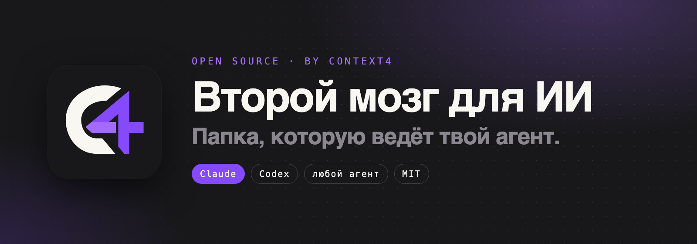
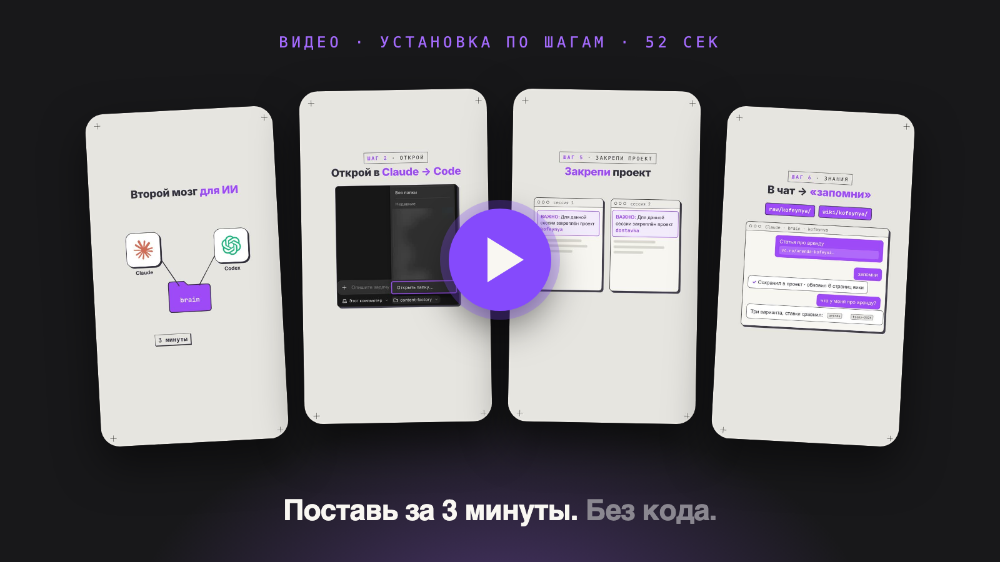
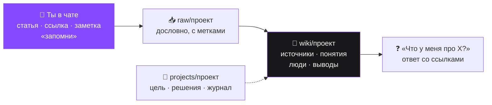
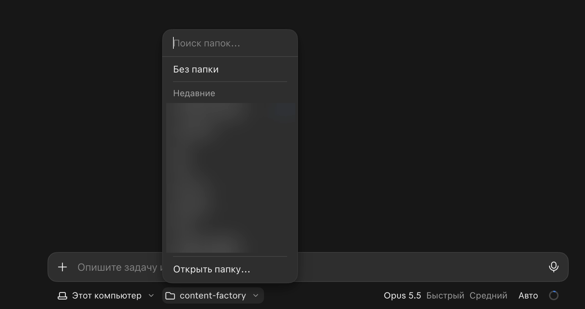
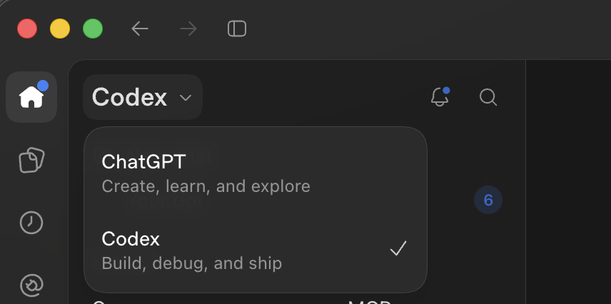
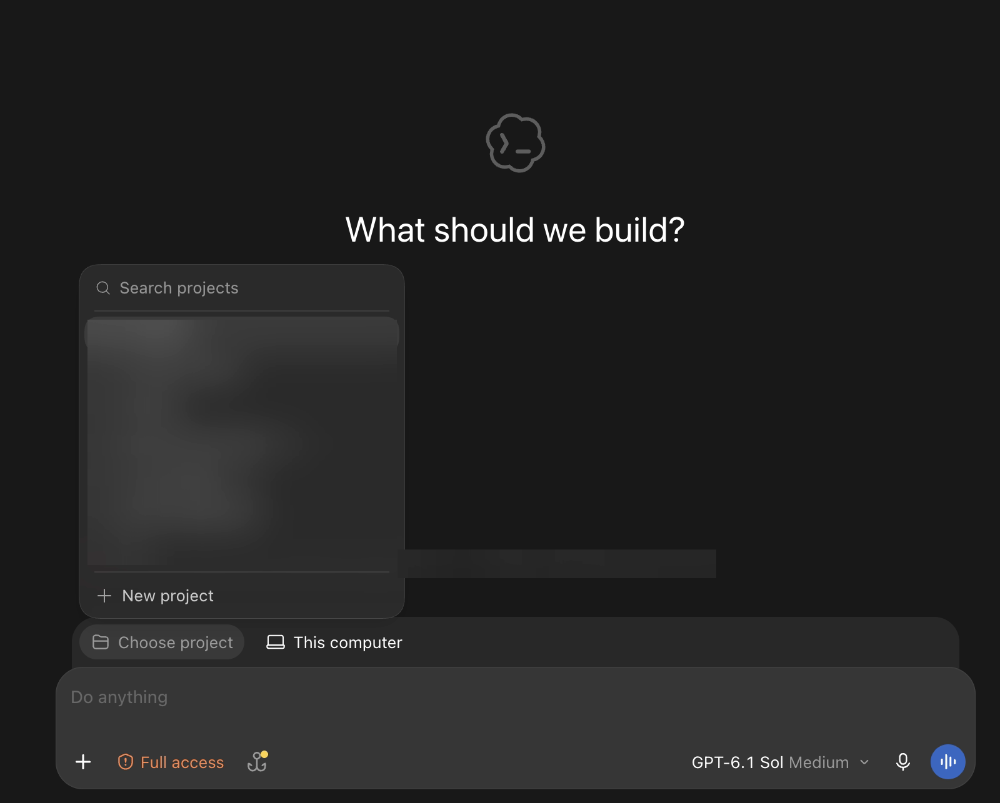
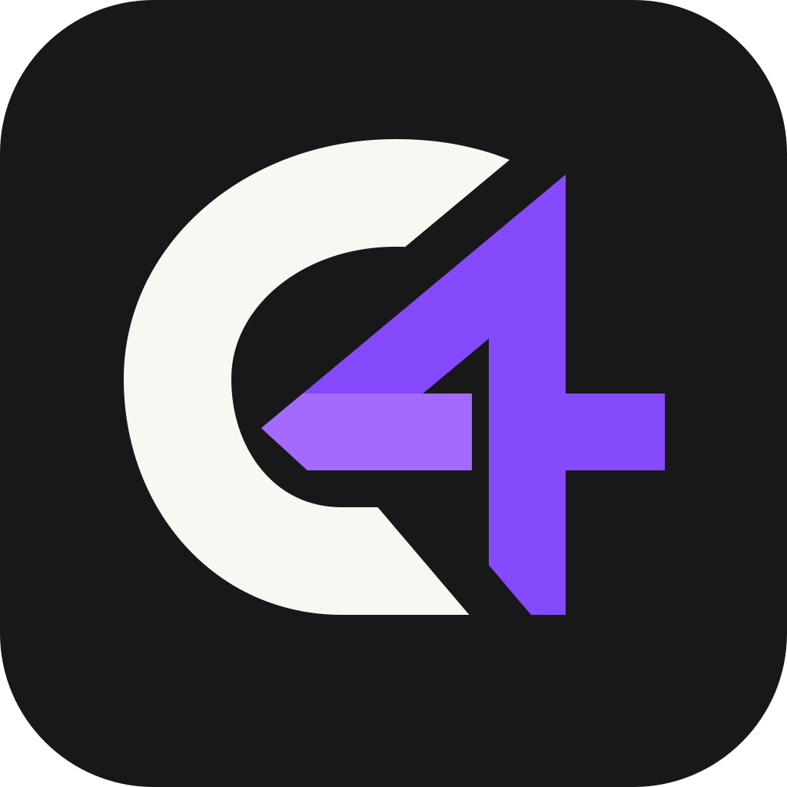

<div align="center">



<br>

**Ты присылаешь агенту в чат статьи, ссылки, заметки и рассказываешь о проектах.<br>Он сам раскладывает всё по полочкам и помнит. Сменил ИИ — память осталась.**

<br>

[](#установка-за-3-минуты)
[](#установка-за-3-минуты)
[](#скиллы)
[](LICENSE)

[**Установка**](#установка-за-3-минуты) · [**Как пользоваться**](#как-пользоваться) · [**Проекты**](#проекты) · [**Скиллы**](#скиллы) · [**Вопросы**](#вопросы)

</div>

<br>

## Смотри, как это работает

<a href="docs/media/brain-tutorial.mp4"></a>

<p align="center"><sub>52 секунды: папка → Claude или Codex → одно сообщение → первый проект. Нажми на картинку, чтобы открыть видео.</sub></p>

<br>

## Зачем это нужно

<table>
<tr>
<td width="50%" valign="top">

### 🧠 ИИ перестаёт забывать
Не нужно каждый раз заново объяснять, кто ты, что за проект и что уже решили. Всё лежит в папке — агент читает это сам.

</td>
<td width="50%" valign="top">

### 📚 Знания копятся
Прочитал статью, посмотрел видео — скинул в чат и сказал «запомни». Через месяц спрашиваешь «что у меня про аренду?» — и получаешь ответ со ссылками.

</td>
</tr>
<tr>
<td width="50%" valign="top">

### 🎯 Проекты с ясной целью
Агент не начинает проект с пустого места. Сначала расспросит: зачем он тебе, какая цель, как поймём, что готово, и что ты делаешь завтра.

</td>
<td width="50%" valign="top">

### 🔓 Не зависишь от одного ИИ
Работает в Claude, Codex, Cursor и других агентах. Это обычные файлы у тебя на диске — твои.

</td>
</tr>
</table>

Идея — подход «LLM Wiki» Андрея Карпатого: знания один раз перерабатываются в аккуратную вики и поддерживаются в порядке, а не ищутся заново в куче файлов на каждый вопрос.



<br>

## Установка за 3 минуты

> Программировать не нужно. Агент поставит всё сам.

### 1. Поставь приложение с агентом

| Приложение | Подписка |
|---|---|
| [Claude](https://claude.ai/download) для компьютера, вкладка **Code** | Pro или выше |
| [ChatGPT](https://chatgpt.com/download) для компьютера, режим **Codex** | Plus или выше |

### 2. Создай пустую папку

Например, `Документы/brain`. Там будет жить твой мозг.

### 3. Открой папку в приложении

<details open>
<summary><b>Claude</b> — вкладка Code → выбор папки → «Открыть папку…»</summary>
<br>

Под полем ввода нажми на выбор папки, затем **«Открыть папку…»** и выбери `brain`.



</details>

<details>
<summary><b>Codex</b> — переключись на Codex → Choose project → New project</summary>
<br>

В приложении ChatGPT слева вверху переключись на **Codex**:



Затем внизу **Choose project** → **New project** → выбери `brain`:



</details>

### 4. Вставь агенту одно сообщение

```text
Установи мне второй мозг по инструкции из README: https://github.com/context4/c4-brain
```

### 5. Отвечай на вопросы

Агент скачает файлы, коротко расскажет, что где лежит, и предложит завести первый проект. Если что-то пошло не так — напиши ему, что видишь, он разберётся.

<br>

## Как пользоваться

Всё — через чат. Руками в папки ничего класть не нужно.

| Что хочешь | Что сказать агенту |
|---|---|
| 🎯 Завести проект | «Заведи проект» — и отвечай на вопросы. Пока не ответишь на главное, проект не создастся. |
| 📌 Начать работу | «Работаем с проектом кофейня». Агент закрепит проект на эту сессию и не полезет в чужие. |
| 📥 Добавить знания | Пришли текст, ссылку или файл и скажи «запомни». Агент сохранит в проект и разложит по вики. |
| 🔎 Найти ответ | «Что у меня есть про X?» — ответ по твоей вики со ссылками. Хороший ответ попроси сохранить. |
| 💡 Разобраться в мутной задаче | «Давай побрейнштормим» — агент уточнит цель и предложит 2–3 варианта. |
| 🛠 Сделать что-то большое | «Сделай план» → «делай». Агент пойдёт по шагам и проверит каждый. |
| 🔌 Подключить сервис | «Подключи amoCRM к проекту». Агент проверит каталог Context4 и подключит через него. |
| 🧹 Навести порядок | «lint» — раз в неделю. Найдёт противоречия, пробелы и заброшенные проекты. |

> [!TIP]
> Несколько проектов одновременно — открой несколько сессий, в каждой свой проект. В начале сессии агент покажет: **«ВАЖНО: Для данной сессии закреплён проект …»** — и будет работать только в нём.

> [!NOTE]
> Удобно смотреть вики в [Obsidian](https://obsidian.md): открой папку как хранилище, и ссылки между страницами заработают.

<br>

## Проекты

Проект — то, ради чего ты вообще копишь знания. Поэтому агент **никогда не заводит проекты сам**: только по твоей просьбе и только после интервью.

У каждого проекта — свой раздел в каждой папке, а всё общее лежит в разделе `general`:

```
raw/<проект>/       всё, что ты прислал в чат, дословно — агент сохраняет сам и больше не правит
wiki/<проект>/      вики проекта: источники, понятия, люди и компании, выводы
plans/<проект>/     планы
outputs/<проект>/   результаты
projects/<проект>/  паспорт проекта
```

Паспорт проекта всегда устроен одинаково:

```
projects/<проект>/
├── project.yaml   статус, даты, люди, ссылки, подключённые сервисы
├── README.md      зачем, цель, критерий готовности, ограничения, риски, следующие шаги
├── interview.md   твои ответы из интервью, дословно
├── decisions.md   что решили, почему и какие были варианты
├── log.md         что и когда делали
├── notes/         заметки и черновики
└── assets/        рабочие файлы: логотипы, макеты, выгрузки
```

<br>

## Скиллы

Скиллы — записанные инструкции, которые агент подгружает сам, когда задача подходит. Ставить ничего не нужно: они уже внутри, в открытом формате [Agent Skills](https://agentskills.io).

| Скилл | Что делает |
|---|---|
| `c4-project` | Заводит, пересматривает и закрывает проект через интервью |
| `c4-brainstorm` | Проясняет мутную задачу: цель, ограничения, критерии, 2–3 варианта на выбор |
| `c4-plan` | План по шагам с проверками |
| `c4-cook` | Делает план шаг за шагом и проверяет каждый |
| `c4-scout` | Быстро находит нужные файлы, ничего не меняя |
| `context4` · `context4-setup` · `context4-workflows` | Подключение и работа с CRM, задачами, почтой, GitHub через [Context4](https://ctx4.me) |

Обычный путь большой задачи: **брейншторм → план → «делай»**. Свои скиллы можно добавлять в ту же папку `.agents/skills/`.

<br>

## Вопросы

<details>
<summary><b>Где хранятся мои данные?</b></summary>
<br>
Только у тебя на компьютере, в папке, которую ты создал. Это обычные текстовые файлы. Не публикуй свою папку в открытый доступ — там твои личные записи.
</details>

<details>
<summary><b>Можно перейти с Claude на Codex и обратно?</b></summary>
<br>
Да. Правила лежат в <code>AGENTS.md</code>, скиллы — в <code>.agents/skills/</code>; Claude, Codex и другие агенты читают одно и то же. Открываешь ту же папку в другом приложении — и продолжаешь.
</details>

<details>
<summary><b>Работает на Windows?</b></summary>
<br>
Да. Если скиллы не видны в Claude Code, попроси агента: «проверь, что скиллы на месте» — он скопирует их куда нужно.
</details>

<details>
<summary><b>Нужно ли знать программирование?</b></summary>
<br>
Нет. Ты только создаёшь папку, открываешь её в приложении и вставляешь одно сообщение. Дальше — обычный разговор.
</details>

<br>

## Что внутри репозитория

```
AGENTS.md                    правила для агента (CLAUDE.md и GEMINI.md подключают его)
.agents/skills/              скиллы (.claude/skills — ссылка сюда же)
raw/ wiki/ plans/ outputs/   разделы general; разделы проектов появятся сами
projects/                    паспорта проектов
index.md · log.md            каталог и журнал
docs/                        картинки и видео для этой страницы
```

<br>

---

## Для агента: установка

Ты читаешь это, потому что человек попросил установить второй мозг. Человек может быть не программистом: делай всё сам, объясняй простыми словами, без жаргона. Ссылка на репозиторий: `https://github.com/context4/c4-brain`.

1. **Проверь папку.** Ставим в текущую рабочую папку.
   - Если в ней уже есть `AGENTS.md` и `.agents/skills/c4-project/` — мозг уже стоит, переходи к шагу 5.
   - Если папка не пустая — покажи, что в ней лежит, и спроси: ставить сюда (существующие файлы не трогаем) или создать вложенную папку `brain/`. Никогда не перезаписывай и не удаляй файлы человека.
2. **Скачай.**
   - Есть `git`: в пустую папку — `git clone https://github.com/context4/c4-brain.git .`; в непустую — клонируй во временную папку и скопируй содержимое (включая скрытые `.agents`, `.claude`, `.gitignore`), пропуская файлы, которые уже существуют. Затем `git remote rename origin upstream`, чтобы личный мозг случайно не отправлялся в общий репозиторий.
   - Нет `git`: скачай архив `https://github.com/context4/c4-brain/archive/refs/heads/main.zip`, распакуй во временную папку и скопируй содержимое папки `c4-brain-main/` так же. Предложи человеку поставить git позже — не обязательно.
   - Папка `docs/` — только картинки и видео для страницы на GitHub. В мозге человека она не нужна: удали её из установленной папки.
3. **Проверь скиллы.** `.claude/skills` должна указывать на `.agents/skills` (символическая ссылка). Если это не так (часто на Windows или после архива) — удали неработающую ссылку и скопируй папку `.agents/skills` в `.claude/skills`.
4. **Проверь, что всё на месте:** `AGENTS.md`, `CLAUDE.md`, `index.md`, `log.md`, разделы `raw/general/`, `wiki/general/`, `plans/general/`, `outputs/general/`, папка `projects/`, и в `.agents/skills/` восемь скиллов (пять `c4-*` и три `context4*`). Если чего-то нет — скажи, чего именно.
5. **Перечитай `AGENTS.md`** из установленной папки и следуй ему. Дальше — первый запуск по разделу «Первый запуск» в `AGENTS.md`: короткое знакомство и предложение завести первый проект.

Не проси человека открывать терминал или вводить команды — делай это сам. Если что-то требует его действия (поставить git, дать разрешение) — объясни одной фразой, зачем, и что нажать.

---

<div align="center">



<sub>Сделано в <a href="https://ctx4.me">Context4</a> · MIT — см. <a href="LICENSE">LICENSE</a> · скиллы <code>c4-plan</code> и <code>c4-brainstorm</code> основаны на AgentKit (MIT), см. <a href="NOTICE">NOTICE</a></sub>

</div>
